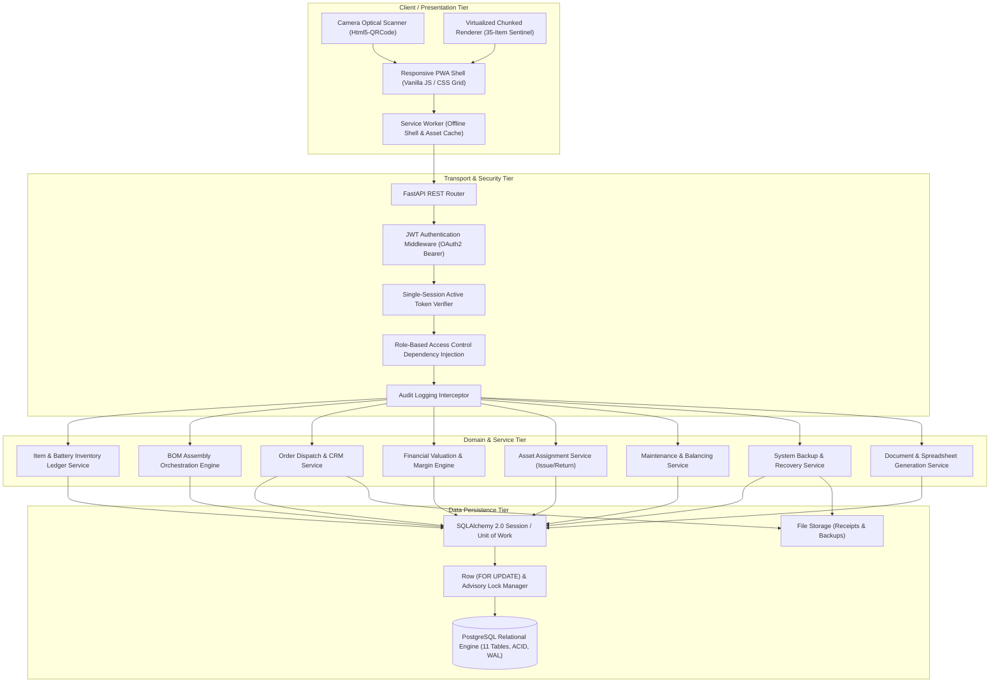
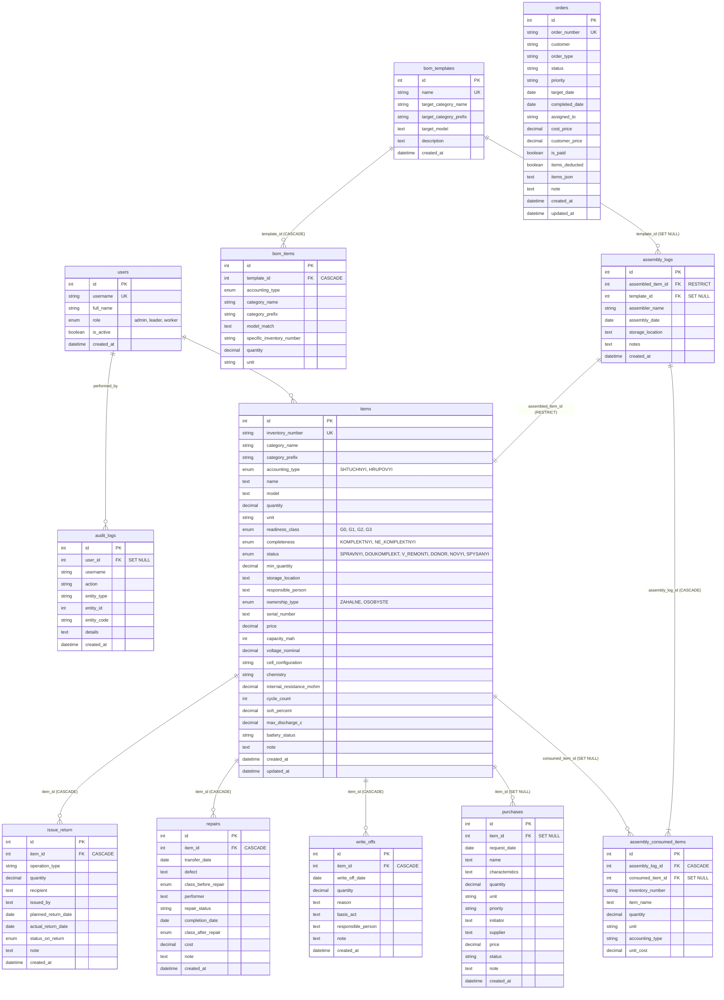
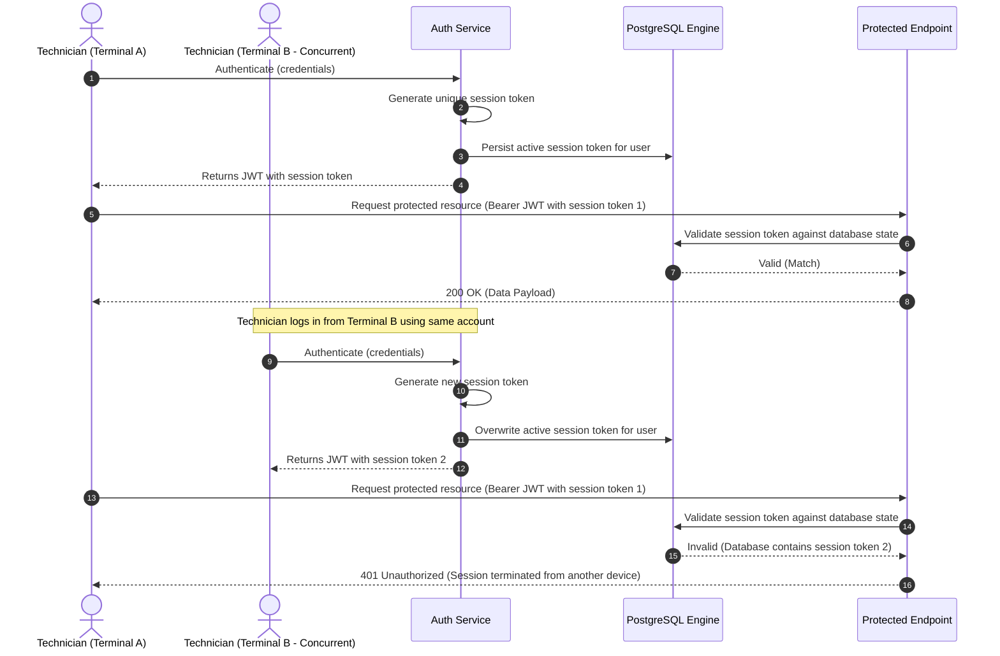
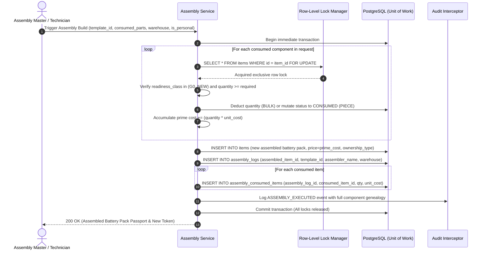

# System Architecture Specification (Deus Battery ERP)
> **Structured following IEEE 1016 SDD conventions**

---

## 1. Architectural Goals & Design Philosophy

The **Deus Battery ERP** architecture is engineered around the core principles of deterministic state management, transactional integrity, electro-chemical safety, and operational simplicity. High-throughput battery assembly workshops and cell testing laboratories require immediate real-time response times with zero risk of concurrency-induced stock anomalies (e.g., negative stock, double-spending of cells during parallel bench assemblies, or race conditions during order dispatch).

### Core Architectural Principles:
1. **Modular Monolith:** Presentation, business logic, domain services, and persistence interfaces are co-located within a single cohesive deployment unit to eliminate network partitioning overhead and latency while enforcing strict internal service boundaries.
2. **Strict Referential Integrity:** Foreign keys enforce explicit cascading and deletion rules (`ON DELETE RESTRICT` for assembled battery packs and consumed sub-components), guaranteeing that historical production records can never be orphaned or corrupted.
3. **Database-Level Concurrency Isolation:** Critical inventory decrementing and state transitions utilize row-level pessimistic locking (`SELECT ... FOR UPDATE`) in PostgreSQL, preventing "lost update" anomalies during simultaneous multi-bench operations.
4. **Single Active Session State Governance:** Database-backed session verification enforces single active login tokens per user, preventing account credential sharing across simultaneous workstations.
5. **Client-Agnostic REST Contracts:** Clear architectural decoupling between the backend API and the presentation layer, allowing standard web browsers, mobile PWA clients, and automated battery testing analyzers to consume the same secure endpoints.

---

## 2. Layered System Decomposition

The system is organized into four distinct, loosely coupled architectural tiers:



---

## 3. Relational Schema & Entity-Relationship Model

The PostgreSQL database encompasses **11 normalized relational tables** enforcing strict relational constraints:



---

## 4. Concurrency Control & State Consistency

In a high-intensity battery pack assembly workshop, race conditions present critical operational risks (e.g., negative component inventory, double-allocation of cells, conflicting order numbering, or split-brain user sessions).

### 4.1. Pessimistic Row-Level Locking (`FOR UPDATE`)
To guarantee zero negative stock and eliminate "lost update" anomalies during simultaneous multi-bench cell deduction, the system implements **Pessimistic Row-Level Locking** via SQLAlchemy `with_for_update()` in PostgreSQL:

```python
# Atomic row locking pattern implemented across all mutating endpoints
with session.begin():
    item = (
        session.query(Item)
        .filter(Item.id == item_id)
        .with_for_update()  # Acquires exclusive PostgreSQL row-level lock (FOR UPDATE)
        .first()
    )
    if not item:
        raise HTTPException(status_code=404, detail="Entity not found")
        
    if item.accounting_type == AccountingTypeEnum.HRUPOVYI:  # BULK
        if item.quantity < requested_decrement:
            raise HTTPException(status_code=400, detail="Insufficient stock quantity")
        item.quantity -= requested_decrement
    else:
        # Atomic status mutation for piece-wise serialized assets
        if item.status != StatusEnum.SPRAVNYI:
            raise HTTPException(status_code=400, detail="Item is not available for operation")
        item.status = TargetStatusEnum.V_REMONTI
```

### 4.2. Transactional Advisory Locking for Sequence Generation
Sequential identifiers (such as order numbers `ORD-YYYY-XXXX`) require monotonic serialization across concurrent database transactions. Standard `SELECT MAX(...)` queries suffer from race conditions under load. The engine implements PostgreSQL transactional advisory locks:

```python
# Acquire advisory transaction lock scoped to sequence generation
db.execute(
    text("SELECT pg_advisory_xact_lock(:sequence_lock_id)"),
    {"sequence_lock_id": 10001}
)
# Safely compute next sequence number without duplicate key collisions
```

### 4.3. Single Active Session Concurrency Guard
To prevent credential sharing across multiple workshop terminals, every user authentication event generates a unique session token persisted to the user record and embedded in the signed JWT payload.



---

## 5. Bill of Materials (BOM) Assembly Execution Workflow

The assembly workflow coordinates sub-component deduction, battery pack instantiation, dynamic prime cost calculation, and append-only (application-level) audit linkage within a single ACID transaction:



---

## 6. Specifications Reference

- **[System Landing & Project Overview](README.md)**
- **[Traceability & Battery Lifecycle Specification](TRACEABILITY_AND_LIFECYCLE.md)**
- **[Security, Governance & Resilience Specification](SECURITY_AND_RELIABILITY.md)**
