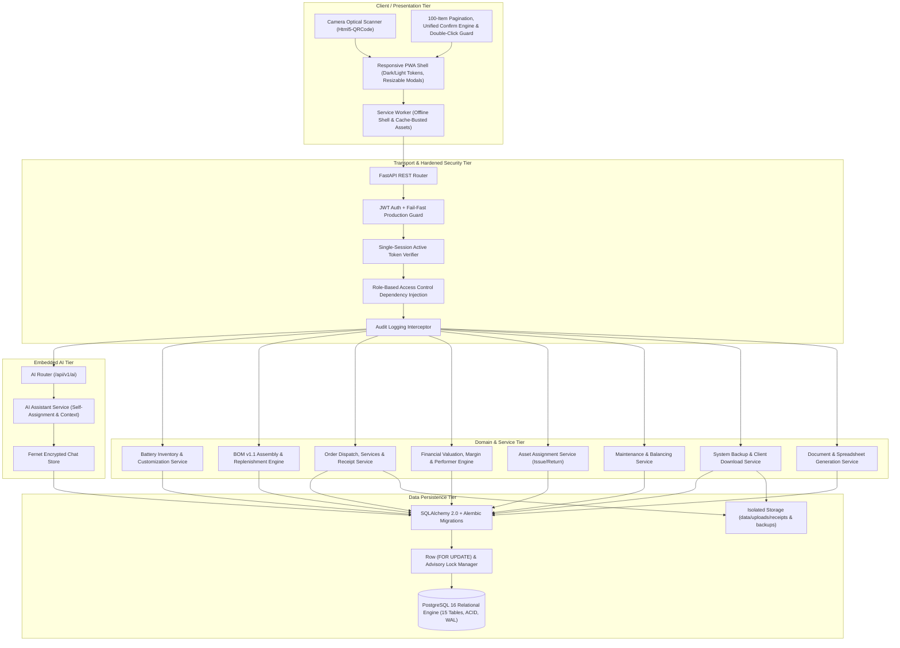
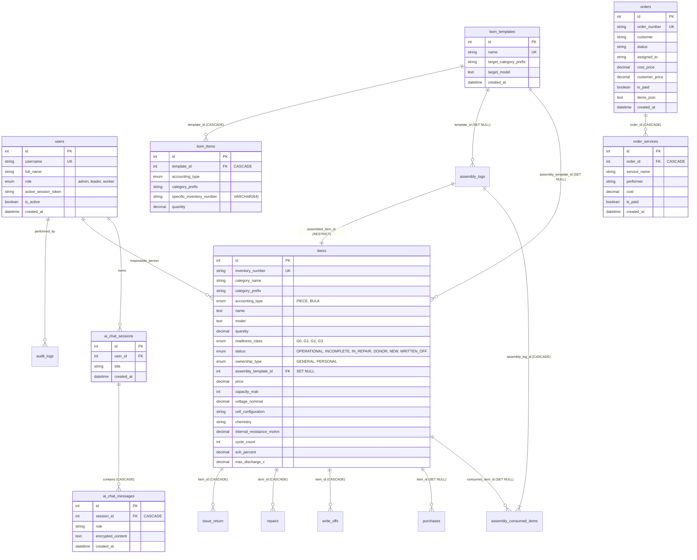

# System Architecture Specification (Deus Battery ERP)
> **Structured following IEEE 1016 SDD conventions**

---

## 1. Architectural Goals & Design Philosophy

The **Deus Battery ERP** architecture is engineered around deterministic state management, transactional integrity, electro-chemical safety, and defense-in-depth security. High-throughput battery assembly workshops and cell testing laboratories require immediate real-time responsiveness with zero risk of concurrency-induced stock anomalies or unauthorized access to protected financial records.

### Core Architectural Principles:
1. **Modular Monolith:** Presentation, business logic, AI services, and persistence interfaces are co-located within a single cohesive deployment unit to eliminate network partitioning overhead while enforcing strict internal service boundaries.
2. **Strict Referential Integrity:** Foreign keys enforce explicit deletion rules (`ON DELETE RESTRICT` for assembled battery packs and consumed sub-components; `ON DELETE SET NULL` for template references), guaranteeing permanent production genealogy.
3. **Database-Level Concurrency Isolation:** Critical inventory decrements and state transitions utilize pessimistic row-level locking (`SELECT ... FOR UPDATE`) and advisory locking (`pg_advisory_xact_lock`) in PostgreSQL.
4. **Single Active Session State Governance:** Database-backed session verification enforces single active login tokens per user across workshop terminals.
5. **Isolated Protected File Storage:** Sensitive payment receipts and backups reside strictly outside public static mounts (`data/uploads/receipts`), accessible only via authenticated API routes.

---

## 2. Layered System Decomposition

---

## 3. Relational Schema & Entity-Relationship Model

The PostgreSQL 16 database is versioned via **Alembic** (`alembic/versions/`) and encompasses **15 normalized relational tables**:

---

## 4. Concurrency Control & State Consistency

### 4.1. Pessimistic Row-Level Locking (`FOR UPDATE`)
All mutating inventory endpoints acquire exclusive row locks via `session.query(Item).filter(...).with_for_update()` inside an atomic transaction boundary, preventing negative stock and lost updates during simultaneous multi-bench cell deductions.

### 4.2. Transactional Advisory Locking for Sequence Generation
Sequential order identifiers (`ORD-YYYY-XXXX`) are serialized across concurrent transactions via PostgreSQL `SELECT pg_advisory_xact_lock(:sequence_lock_id)`.

### 4.3. Single Active Session Concurrency Guard
Every authentication event generates a fresh session token persisted on `users` and embedded in the signed JWT. Concurrent logins from a second terminal immediately invalidate the prior session token (`401 Unauthorized`), preventing shared-credential access.

---

## 5. Embedded AI Assistant & Encrypted Persistence (`app/ai/*`)

- **Authenticated Operator Context:** When an operator requests order creation via the AI assistant ("assign to me" or omitted assignee), the post-processing layer resolves `assigned_to = current_user.full_name` deterministically from the verified JWT identity.
- **Encrypted Chat History:** Conversations are persisted in `ai_chat_sessions` and `ai_chat_messages` using Fernet symmetric encryption, isolating dialog history at rest.

---

## 6. UI State Engineering & Database Versioning

1. **Alembic Schema Versioning:** Relational migrations are tracked under `alembic/versions/` with baseline and additive schema upgrades tested against production snapshots.
2. **Incremental Pagination & Collapsible Filters:** 100-row chunked pagination across operational registries paired with collapsible filter panels displaying live active-filter counts.
3. **Modal Persistence & Safety:** Modal dialogs support drag-resizing persisted per modal ID in `localStorage`, disable accidental backdrop-click dismissal, and coordinate via a unified promise-based confirmation controller.
4. **Double-Click Idempotency & WebKit OOM Mitigation:** Action buttons enforce in-flight locks; mobile viewports (`<= 768px`) render exclusive card layouts and unmount/hide inactive overlays.

---

## 7. Specifications Reference

- **[System Landing & Project Overview](README.md)**
- **[Traceability & Battery Lifecycle Specification](TRACEABILITY_AND_LIFECYCLE.md)**
- **[Security, Governance & Resilience Specification](SECURITY_AND_RELIABILITY.md)**
