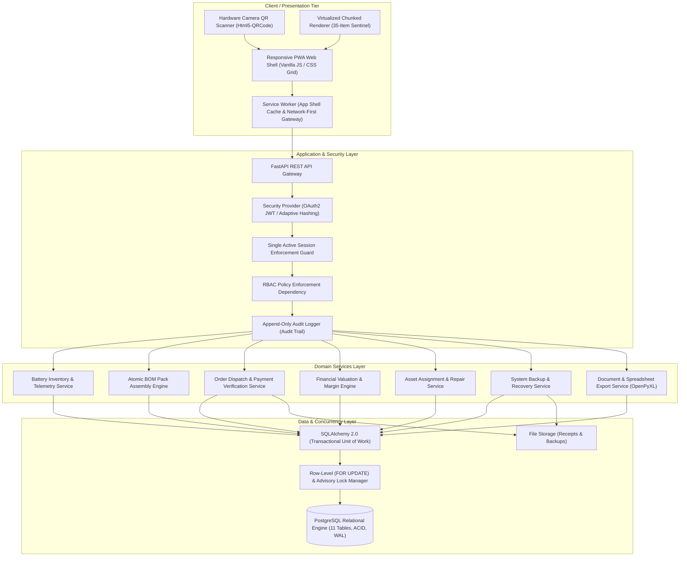

# DEUS BATTERY ERP: SYSTEM ARCHITECTURE & BATTERY LIFECYCLE SPECIFICATION
> **Enterprise Resource Planning, Electro-Chemical Battery Pack Assembly, and Component Traceability Platform for Battery Systems**

---

> [!NOTE]
> **Repository Scope & Architectural Showcase**:  
> This repository serves as a **System Architecture & Technical Specifications Showcase** presenting the engineering design, domain boundaries, finite state machines, threat modeling, electro-chemical data models, and concurrency control protocols of the Deus Battery ERP platform.  
> Production deployment code, proprietary battery pack schematics, hardware testing firmware, and operational database migrations are maintained in an enterprise private repository under organizational access control.

---

## 1. Executive Summary

**Deus Battery ERP** is an industrial-grade enterprise inventory, assembly, and lifecycle traceability platform engineered specifically for high-throughput battery pack manufacturing facilities, cell testing laboratories, and battery assembly and maintenance workshops.

The platform addresses critical supply chain, chemical safety, and production engineering bottlenecks in multi-cell power manufacturing:
- **Electro-Chemical Cell & Pack Telemetry:** Granular tracking of nominal voltages, internal resistance ($m\Omega$), State of Health ($\text{SOH}\%$), cycle counts, charge/discharge C-ratings, and series/parallel cell topologies (e.g., 6S2P, 4S1P, 12S1P).
- **Dual-Ownership Accounting:** Architectural isolation separating company-owned inventory (`ZAHALNE`) from master-owned personal assemblies (`OSOBYSTE`), preventing balance distortion and cross-entity financial contamination.
- **Atomic BOM Pack Assembly:** Multi-row Bill of Materials execution coordinating cell batch deductions, BMS board integration, wiring allocation, and finished pack instantiation within a single atomic database transaction (`SELECT ... FOR UPDATE` isolation).
- **Single Active Session Token Guard:** Server-enforced session tracking guaranteeing that user credentials cannot be shared concurrently across multiple terminals or devices.
- **Optical Asset Identification:** Anti-enumeration, cryptographically tokenized QR codes for rapid camera scanning in workshop environments.

---

## 2. Core Functional Modules

### 2.1. Electro-Chemical Battery Inventory Ledger
The inventory engine manages raw cells, BMS modules, nickel strips, silicon wiring, connectors, and assembled battery packs across **multi-warehouse topologies** (Storage Warehouses 1–4). Equipment operates under two mathematical accounting models:
- **Piece-wise Serialized Accounting (`PIECE`):** Unique serial serialization with dedicated QR verification tokens, electro-chemical metrics, and individual operator assignments (e.g., assembled 6S2P battery packs, specialized bench testing analyzers, spot-welding stations).
- **Bulk Batch Accounting (`BULK`):** Grouped inventory managed by fractional decimal quantities, shared SKU/QR codes, and atomic deductions during pack assembly (e.g., individual 21700 / 18650 cells, nickel sheets, AWG wiring, balance leads, XT60/XT90 connectors).

### 2.2. Dual-Ownership Governance (`ZAHALNE` vs `OSOBYSTE`)
In high-performance assembly workshops, certified technicians frequently assemble custom packs utilizing personal components or for specialized projects:
- **General Stock (`ZAHALNE`):** Capitalized enterprise property subject to formal corporate financial valuation, general order dispatch, and company balance sheets.
- **Personal Assembly (`OSOBYSTE`):** Segregated technician property tracked within the same operational ledger for maintenance history and safety traceability, but strictly excluded from general commercial order allocation and company inventory valuations.

### 2.3. Atomic Bill of Materials (BOM) Assembly Engine
- **Predefined Pack Recipes:** Standardized BOM templates for battery configurations (e.g., 6S2P 8400mAh Molicel P42A, 4S1P 4500mAh LiPo, 12S2P High-Capacity Packs).
- **Dynamic Cost Price Computation:** Real-time summation of consumed cell purchase costs, BMS units, and ancillary hardware dynamically calculating the pack's prime cost (`cost_price`).
- **Referential Integrity (`ON DELETE RESTRICT`):** Assembled battery packs retain permanent relational bindings to all consumed components, eliminating orphaned production records.

### 2.4. Production Order Orchestration & Dispatch (CRM)
- **Lifecycle Finite State Machine:** Validated progression through operational stages: `NEW` -> `IN_PROGRESS` -> `READY` -> `ISSUED`.
- **Financial & Margin Governance:** Real-time comparison between component BOM prime cost (`cost_price`) and client quotation (`customer_price`), gross margin calculation, payment verification (`is_paid`), and uploaded payment receipt archival.
- **Collision-Free Sequence Generation:** Transactional advisory locking (`pg_advisory_xact_lock`) eliminates sequence race conditions across simultaneous workstation dispatches.

### 2.5. Governance & Append-Only (Application-Level) Audit Logging
- **Append-Only Audit Trail:** Centralized mutation logging capturing actor ID, timestamp, client IP, action tag, entity type/code, and structured JSON state deltas.
- **Taxonomy Validation:** Critical categorical attributes (`Readiness Class`, `Status`, `Completeness`, `Ownership Type`) are strictly governed by database-level enumerations.

---

## 3. High-Level Architecture

The platform is designed as an enterprise **Modular Monolith** prioritizing transactional safety, zero network partition overhead, and real-time operational reactivity.

---

## 4. Technical Stack

| Tier | Technology | Technical Purpose |
|---|---|---|
| **Backend Engine** | Python 3.11+, FastAPI, Starlette | High-performance asynchronous REST API framework |
| **ORM & Concurrency** | SQLAlchemy 2.0, PostgreSQL Driver | Declarative relational schema, session lifecycle, row & advisory locks |
| **Database Engine** | PostgreSQL (ACID, WAL enabled) | Relational storage with strict foreign keys, enums, and check constraints |
| **Authentication & RBAC** | OAuth2 Password Bearer, signed JWT, adaptive password hashing | Stateless cryptographic tokens with stateful database session verification |
| **Client UI Shell** | HTML5, CSS3 Variables, Vanilla JavaScript (ES6) | Framework-less, zero-build responsive web application |
| **Mobile Integration** | Service Worker, Web App Manifest | Installable Progressive Web Application (PWA) with offline shell caching |
| **Optical Identification** | Html5-QRCode, QRCode.js | Client-side cryptographic QR generation and camera-based decoding |
| **Document Generation** | OpenPyXL, Print-Optimized CSS | Structured spreadsheet reporting and standardized battery transfer deeds |

---

## 5. Role-Based Access Control (RBAC)

The system enforces the Principle of Least Privilege (PoLP) across three standardized operational roles:

| Operational Capability | Worker (`worker`) | Lead Technician (`leader`) | Administrator (`admin`) |
|---|:---:|:---:|:---:|
| Read Inventory Registry & Battery Telemetry | ✅ | ✅ | ✅ |
| Scan & Resolve Optical QR Tokens | ✅ | ✅ | ✅ |
| Execute Asset Assignment Check-out / Check-in | ✅ | ✅ | ✅ |
| Create & Transition Orders (`NEW` -> `IN_PROGRESS` -> `READY` -> `ISSUED`) | ✅ | ✅ | ✅ |
| Submit Maintenance & Balancing Tickets | ✅ | ✅ | ✅ |
| Execute BOM Battery Pack Assemblies | ❌ | ✅ | ✅ |
| Create / Edit Inventory SKUs & Cell Types | ❌ | ✅ | ✅ |
| Toggle Order Payment Status & Upload Receipts | ❌ | ✅ | ✅ |
| Govern Order Quotations, Costs & Margins | ❌ | ✅ | ✅ |
| Inspect Financial Analytics & Warehouse Valuation | ❌ | ✅ | ✅ |
| Export Analytical Reports & Transfer Deeds | ❌ | ✅ | ✅ |
| Inspect Append-Only Audit Trail Logs | ❌ | ✅ | ✅ |
| Manage User Accounts & Reset Sessions | ❌ | ❌ | ✅ |
| Trigger Database Backups & Restores | ❌ | ❌ | ✅ |

---

## 6. Automated Testing & Verification Suite

The platform maintains comprehensive test coverage verifying operational invariants, concurrency locking, and schema validations.

The test suite covers the following invariants:
- Zero negative stock during simultaneous bulk cell deductions.
- Automatic validation preventing personal items (`OSOBYSTE`) from corrupting corporate valuation.
- Monotonic collision-free order sequence generation under high concurrency.
- Single active session token revocation upon concurrent login.
- Cascading delete protection (`RESTRICT`) preventing accidental deletion of parent assembly logs.

---

## 7. Reliability & Disaster Recovery Highlights

- **Concurrency Isolation:** Row-level locks (`SELECT ... FOR UPDATE`) eliminate lost update anomalies during concurrent multi-bench cell allocation.
- **Recovery Point Objective (RPO) Design Target:** $< 24$ hours via automated nightly logical backups.
- **Recovery Time Objective (RTO) Design Target:** $< 15$ minutes via automated database restore procedures.
- **Retention & Backup Rotation:** Automated 7-snapshot rolling FIFO retention pool with non-zero file size and checksum verification.

---

## 8. Specifications & Documentation Index

For detailed architectural diagrams, mathematical formulations, and engineering designs, refer to the documentation suite:

- **[System Architecture Specification](ARCHITECTURE.md)** — Structured following IEEE 1016 SDD conventions, ER diagrams, atomic transaction models, single-session architecture, and sequence workflows.
- **[Traceability & Battery Lifecycle](TRACEABILITY_AND_LIFECYCLE.md)** — Electro-chemical telemetry models, dual-ownership paradigm, G0–G3 readiness finite state machines, and battery passport genealogy.
- **[Security, Governance & Resilience](SECURITY_AND_RELIABILITY.md)** — Threat modeling (STRIDE), QR tokenization architecture, single active session guard, append-only (application-level) audit logging, and disaster recovery.
