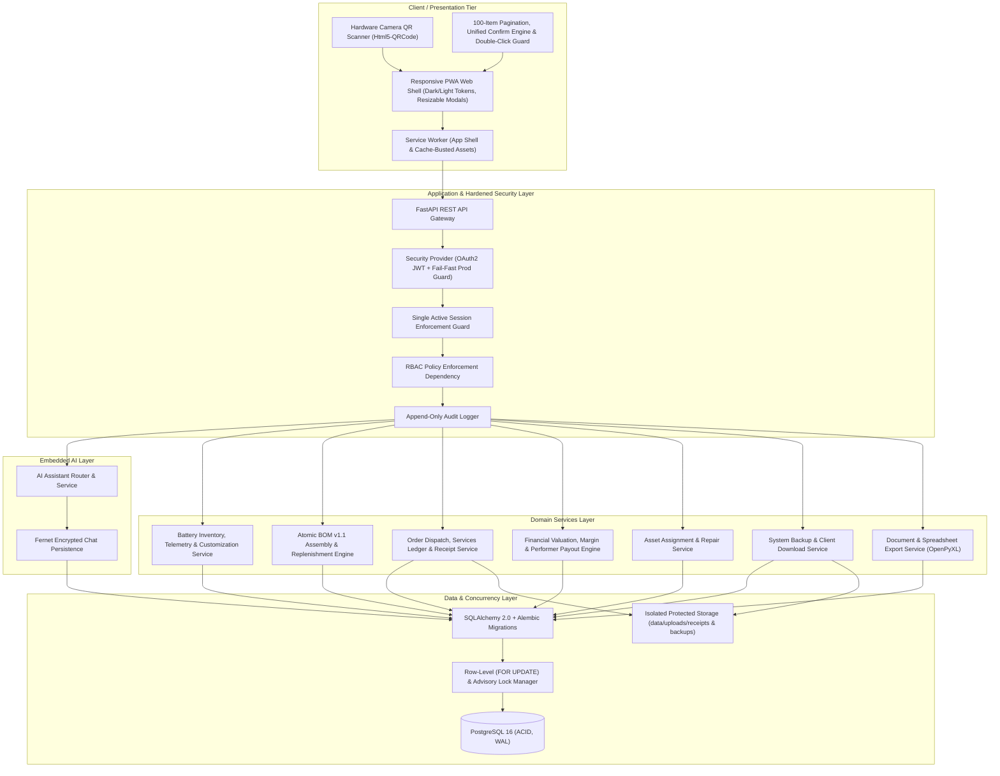

# DEUS BATTERY ERP: SYSTEM ARCHITECTURE & BATTERY LIFECYCLE SPECIFICATION
> **Enterprise Resource Planning, Electro-Chemical Battery Pack Assembly, Embedded AI Assistant, and Component Traceability Platform for Battery Systems**

---

> [!NOTE]
> **Repository Scope & Architectural Showcase**:
> This repository serves as a **System Architecture & Technical Specifications Showcase** presenting the engineering design, domain boundaries, finite state machines, threat modeling, electro-chemical data models, and concurrency control protocols of the **Deus Battery ERP** platform.
> Production deployment code, proprietary battery pack schematics, hardware testing firmware, and operational database migrations are maintained in a private repository under organizational access control.

---

## 1. Executive Summary

**Deus Battery ERP (ERP 1.1)** is an industrial-grade enterprise inventory, assembly, and lifecycle traceability platform engineered for high-throughput battery pack manufacturing facilities, cell testing laboratories, and battery maintenance workshops.

The platform addresses critical supply chain, chemical safety, security, and production engineering bottlenecks:
- **Electro-Chemical Cell & Pack Telemetry:** Granular tracking of nominal voltages, internal resistance ($m\Omega$), State of Health ($\text{SOH}\%$), cycle counts, charge/discharge C-ratings, and series/parallel cell topologies (e.g., 6S2P, 4S1P, 12S1P).
- **Dual-Ownership Accounting:** Architectural isolation separating company-owned inventory (`GENERAL`) from master-owned personal assemblies (`PERSONAL`), blocking unauthorized cross-entity consumption of personal cells.
- **High-Volume BOM Assembly (ERP 1.1):** Scaled batch assembly up to `5,000` units per run, unlimited BOM component rows (`64`-char SKU matching), group-batch accounting (`BULK`) for finished packs/equipment, and template-bound replenishment (`assembly_template_id`) with selectable cost-basis strategy (weighted-average vs preserve-cost).
- **Order Services & Margin Governance:** Dedicated `order_services` ledger with independent performer payout tracking (`is_paid`) decoupled from client payment status, plus protected multi-format receipt archival.
- **Embedded AI Assistant ("Jarvis"):** Encrypted conversational operations assistant with context-aware self-assignment to the authenticated operator.
- **Hardened Security & Session Guard:** Isolated protected receipt storage (`data/uploads/receipts`) preventing static path-normalization bypasses, Fail-Fast production JWT validation, and single active session enforcement.

---

## 2. Core Functional Modules

### 2.1. Electro-Chemical Battery Inventory Ledger
The inventory engine manages raw cells, BMS modules, nickel strips, silicon wiring, connectors, and assembled battery packs across **multi-warehouse topologies** and **customizable categories** (`app/routers/customization.py`):
- **Piece-wise Serialized Accounting (`PIECE`):** Individual unit serialization with dedicated QR verification tokens, electro-chemical telemetry, and operator assignments.
- **Bulk & Group-Batch Accounting (`BULK`):** Scaled in ERP 1.1 to cover high-volume finished battery packs, products, and equipment in addition to raw cells and consumables, supporting atomic deductions and balance valuation (`quantity * price`).

### 2.2. Dual-Ownership Governance (`GENERAL` vs `PERSONAL`)
- **General Stock (`GENERAL`):** Capitalized enterprise property subject to corporate financial valuation, general order dispatch, and cross-warehouse consumption.
- **Personal Assembly (`PERSONAL`):** Segregated technician property tracked for maintenance and safety traceability, strictly excluded from corporate valuation and protected against unauthorized deduction in general builds.

### 2.3. Atomic Bill of Materials (BOM) Assembly Engine (ERP 1.1)
- **Unlimited Component Specifications:** Supports arbitrary component counts per template with 64-character specific inventory number matching and global cross-category component search.
- **Batch Scaling & Replenishment:** Single-act production runs up to `5,000` units with optional replenishment of existing template-matched stock (`assembly_template_id`) using either weighted-average recalculation or preserved unit cost.
- **Referential Integrity (`ON DELETE RESTRICT`):** Assembled battery packs retain permanent relational bindings to consumed cells and BMS units.

### 2.4. Production Order Orchestration & Services Journal
- **Lifecycle Finite State Machine:** Validated progression through `NEW` -> `IN_PROGRESS` -> `READY` -> `ISSUED` with `pg_advisory_xact_lock` collision-free numbering.
- **Order Services Journal (`order_services`):** Arbitrary per-order services with performer attribution, decoupled `is_paid` settlement flags, interactive KPI drill-downs, and period-filtered performer expense aggregation.
- **Protected Receipt Archival:** Multi-format payment receipts (`.jpg`, `.png`, `.pdf`, `.webp`, `.heic`, `.heif`) stored outside public static mounts and served exclusively behind JWT authorization.

### 2.5. Embedded AI Assistant & UI/UX Engineering
- **AI Operations Assistant (`app/routers/ai.py`, `app/ai/*`):** Encrypted chat history (`ai_chat_sessions`, `ai_chat_messages`) and automatic operator self-assignment when creating orders.
- **Modern Responsive UI:** Dark/Light semantic theme tokens, 100-item incremental pagination, collapsible filter bars with active counters, `localStorage`-persisted resizable modals, double-click idempotency guards, unified confirmation/prompt dialogs, and client-authorized backup downloads.

---

## 3. High-Level Architecture

---

## 4. Technical Stack

| Tier | Technology | Technical Purpose |
|---|---|---|
| **Backend Engine** | Python 3.12+, FastAPI, Starlette | High-performance asynchronous REST API framework |
| **ORM & Migrations** | SQLAlchemy 2.0, Alembic | Declarative relational schema, baseline & additive migrations, row/advisory locks |
| **Database Engine** | PostgreSQL 16 (ACID, WAL enabled) | Relational storage with strict foreign keys, enums, and check constraints |
| **Authentication & RBAC** | OAuth2 JWT, Fail-Fast Guard, Single-Session Guard | Stateless cryptographic tokens with stateful session verification |
| **AI & Cryptography** | AI Assistant Service, Fernet Encryption | Context-aware order creation and encrypted conversation storage |
| **Client UI Shell** | HTML5, CSS3 Variables (Dark/Light), Vanilla JS (ES6) | Zero-build responsive PWA with resizable modals and pagination |
| **Optical Identification** | Html5-QRCode, QRCode.js | Client-side cryptographic QR generation and camera decoding |
| **Testing & CI/CD** | `pytest` (204+ tests), Docker non-root (`1000:1000`), GHCR | Automated regression suite, pre-deploy backups, adaptive `/health` verification |

---

## 5. Role-Based Access Control (RBAC)

| Operational Capability | Worker (`worker`) | Lead Technician (`leader`) | Administrator (`admin`) |
|---|:---:|:---:|:---:|
| Read Inventory Registry & Battery Telemetry | Yes | Yes | Yes |
| Scan & Resolve Optical QR Tokens | Yes | Yes | Yes |
| Execute Asset Assignment Check-out / Check-in | Yes | Yes | Yes |
| Create & Transition Orders (`NEW` -> `IN_PROGRESS` -> `READY` -> `ISSUED`) | Yes | Yes | Yes |
| Submit Maintenance & Balancing Tickets | Yes | Yes | Yes |
| Execute BOM Battery Pack Assemblies (up to 5,000 units) | No | Yes | Yes |
| Create / Edit Inventory SKUs, Cell Types & Categories | No | Yes | Yes |
| Manage Order Services, Payout Status & Protected Receipts | No | Yes | Yes |
| Govern Order Quotations, Costs & Margins | No | Yes | Yes |
| Inspect Financial Analytics & Warehouse Valuation | No | Yes | Yes |
| Export Analytical Reports & Transfer Deeds | No | Yes | Yes |
| Inspect Append-Only Audit Trail Logs | No | Yes | Yes |
| Manage User Accounts & Reset Sessions | No | No | Yes |
| Trigger Database Backups & Client Downloads | No | No | Yes |

---

## 6. Automated Testing & Reliability Highlights

- **Comprehensive Test Suite (`204+` `pytest` tests):** Verifies zero negative stock under concurrency, `PERSONAL` valuation isolation, `pg_advisory_xact_lock` sequence monotonicity, single active session revocation, `data/uploads/receipts` path-traversal isolation (`404`/`401`/`200`), Fail-Fast production JWT enforcement, and AI self-assignment.
- **Disaster Recovery:** RPO $< 24$ hours via automated nightly and pre-deploy compressed `pg_dump` snapshots (5–7 snapshot rolling retention); RTO $< 15$ minutes via automated restore pipelines; client-authorized backup downloads.

---

## 7. Specifications & Documentation Index

- **[System Architecture Specification](ARCHITECTURE.md)** — IEEE 1016 SDD topology, 15-table ER model, Alembic versioning, AI persistence, and UI state engineering.
- **[Traceability & Battery Lifecycle](TRACEABILITY_AND_LIFECYCLE.md)** — Electro-chemical telemetry, dual-ownership paradigm, ERP 1.1 group-batch replenishment, and order services.
- **[Security, Governance & Resilience](SECURITY_AND_RELIABILITY.md)** — STRIDE threat modeling, isolated receipt storage, Fail-Fast JWT guard, single-session enforcement, and CI/CD recovery.
