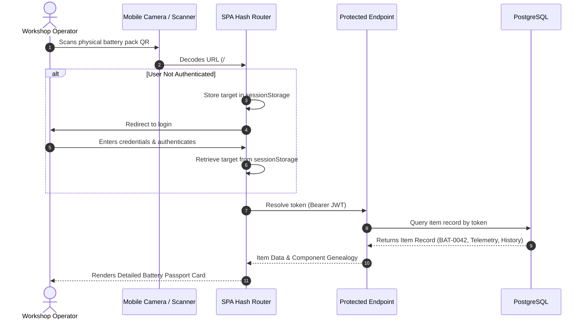
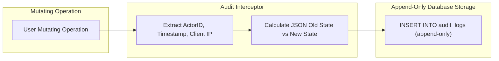
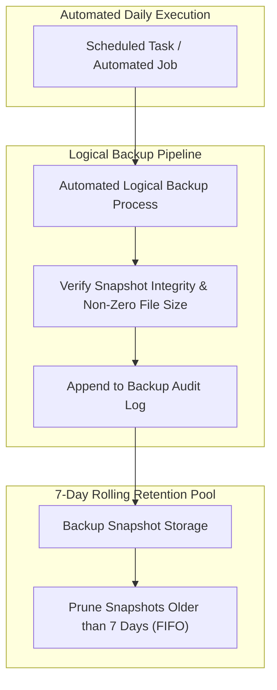

# Security, Governance & Reliability Architecture (Deus Battery ERP)

---

## 1. Threat Modeling (STRIDE Methodology)

High-capacity electro-chemical battery manufacturing and storage facilities present severe physical and operational safety risks. A software compromise leading to incorrect cell assembly, modified charging parameters, or unauthorized disposal creates critical thermal runaway and fire hazards. The system implements mitigations structured according to the **STRIDE** model:

| Threat Category | Potential Attack Vector | Architectural Mitigation |
|---|---|---|
| **Spoofing** | Forged technician identity or credential theft | Adaptive password hashing, signed tokens, and single active session verification. |
| **Tampering** | Unauthorized mutation of battery readiness (e.g. marking damaged pack as operational) | Server-side RBAC policy enforcement at the API boundary; client UI restrictions mirror backend dependency guards. |
| **Repudiation** | Operator denies issuing, modifying, or writing off battery inventory | Append-only (application-level) `AuditLog` capturing actor ID, timestamp, client IP, action name, and JSON state diffs. |
| **Information Disclosure** | Scraping total inventory numbers via predictable QR URLs | Cryptographic tokenization using high-entropy random tokens eliminating sequential asset enumeration. |
| **Denial of Service** | Concurrent request flood exhausting database connections | Transaction timeout constraints, connection pooling with overflow limits, and row-level lock timeouts. |
| **Elevation of Privilege** | Low-privilege worker attempting to execute BOM assemblies or user creation | Role gating enforced by FastAPI dependency injection (`require_role(["leader", "admin"])`). |

---

## 2. Cryptographic QR Tokenization & Anti-Enumeration

### The Sequential Identifier Vulnerability
Early inventory systems often embed sequential identifiers directly into barcode or QR payloads (e.g., `https://<internal-host>/#/item/<opaque-token>`). In competitive environments, this architecture leaks operational data:
- Unauthorized parties can enumerate the full hardware inventory through simple incremental queries.
- Unauthorized parties can deduce total manufacturing throughput, cell depletion rates, and available battery stocks.

### Cryptographic Token Architecture
To mitigate enumeration attacks, every physical asset receives an opaque, cryptographically random verification token generated via high-entropy OS randomness:

```python
import secrets

def generate_secure_token() -> str:
    """Generates a cryptographically secure, high-entropy URL-safe random token.
    High state space makes brute-force enumeration computationally infeasible.
    """
    return secrets.token_urlsafe(16)
```



---

## 3. Role-Based Access Control (RBAC) Architecture

Authentication uses OAuth2 Password Bearer flow with signed JSON Web Tokens (JWT). Authorization is applied per-endpoint via FastAPI dependency injection:

```python
def require_role(allowed_roles: list[UserRoleEnum]):
    """Enforces role-based authorization at the REST endpoint level."""
    def role_checker(current_user: User = Depends(get_current_user)):
        if current_user.role not in allowed_roles:
            raise HTTPException(
                status_code=status.HTTP_403_FORBIDDEN,
                detail="Access denied: Insufficient operational privileges"
            )
        return current_user
    return role_checker
```

### Complete Operational Capability Matrix

| Operational Capability | Worker (`worker`) | Lead Technician (`leader`) | Administrator (`admin`) |
|---|:---:|:---:|:---:|
| User Authentication & Identity Context | ✅ | ✅ | ✅ |
| Read Inventory Registry & Battery Telemetry | ✅ | ✅ | ✅ |
| Resolve Item by QR Token | ✅ | ✅ | ✅ |
| Check-out / Check-in Asset Assignment | ✅ | ✅ | ✅ |
| Create & Transition Production Orders | ✅ | ✅ | ✅ |
| Submit Maintenance & Balancing Tickets | ✅ | ✅ | ✅ |
| Close Maintenance & Balancing Tickets | ✅ | ✅ | ✅ |
| Govern Order Pricing, Costs & Margins | ❌ | ✅ | ✅ |
| Verify Order Payment Status & Record Settlements | ❌ | ✅ | ✅ |
| Inspect Financial Valuation & Analytics | ❌ | ✅ | ✅ |
| Execute BOM Battery Pack Assembly | ❌ | ✅ | ✅ |
| Create / Modify Inventory SKUs & Templates | ❌ | ✅ | ✅ |
| Asset Scrapping & De-allocation (Write-off) | ❌ | ✅ | ✅ |
| Register Inbound Cell & Hardware Procurement | ❌ | ✅ | ✅ |
| Export Registry & Structured Reports | ❌ | ✅ | ✅ |
| Inspect Append-Only Audit Trail Logs | ❌ | ✅ | ✅ |
| User Account Administration & Session Revocation | ❌ | ❌ | ✅ |
| Trigger Database Backups & Restores | ❌ | ❌ | ✅ |

---

## 4. Append-Only (Application-Level) Audit Trail Architecture

All state mutations (modifications to inventory balance, assignment changes, repairs, and deletions) pass through a centralized auditing interceptor:



### Audit Record Schema:
- **`user_id` & `username`:** Forensically links the mutation to the authenticated account.
- **`client_ip`:** Network origin metadata for IP-based traceability.
- **`action`:** Deterministic operation tag (`ITEM_CREATED`, `ASSIGNMENT_ISSUED`, `REPAIR_CLOSED`, `ASSEMBLY_EXECUTED`, `ORDER_STATUS_CHANGED`, `PAYMENT_TOGGLED`).
- **`entity_code` & Sanitization:** String identifiers capped at 64 characters to eliminate `StringDataRightTruncation` exceptions across variable-length component SKUs.
- **`details`:** Structured JSON payload capturing exact entity property state deltas.
- **Application-Level Immutability:** No `UPDATE` or `DELETE` API endpoints exist for audit logs; mutations are strictly append-only.

---

## 5. Resilience, Disaster Recovery & Automated Backup Rotation

High-reliability engineering requires robust disaster recovery protocols capable of restoring full operational capacity in the event of hardware or storage failure. The system implements automated nightly logical backups with integrity verification and rolling retention.



### Operational Recovery Metrics:
- **Recovery Point Objective (RPO) Design Target:** $< 24$ hours. In the event of catastrophic storage failure, maximum potential data loss is limited to transactions committed since the last automated nightly dump.
- **Recovery Time Objective (RTO) Design Target:** $< 15$ minutes. Automated restore procedures can re-provision the relational schema, foreign key constraints, and table datasets from backup snapshots within minutes.
- **Retention Policy (FIFO Rotation):** The automated backup engine maintains a strict rolling pool of the **7 most recent backup snapshots**, preventing storage volume exhaustion on host systems.

---

## 6. Related Technical Specifications

- 📄 **[System Landing & Project Overview](README.md)**
- 🏛️ **[System Architecture Specification](ARCHITECTURE.md)**
- 🔄 **[Traceability & Battery Lifecycle](TRACEABILITY_AND_LIFECYCLE.md)**
