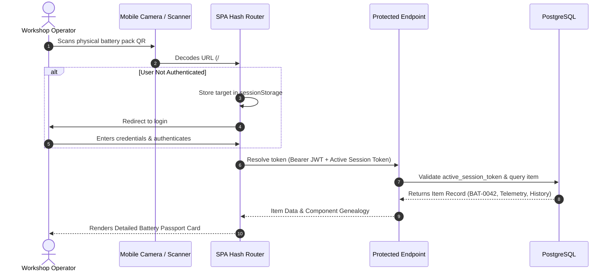
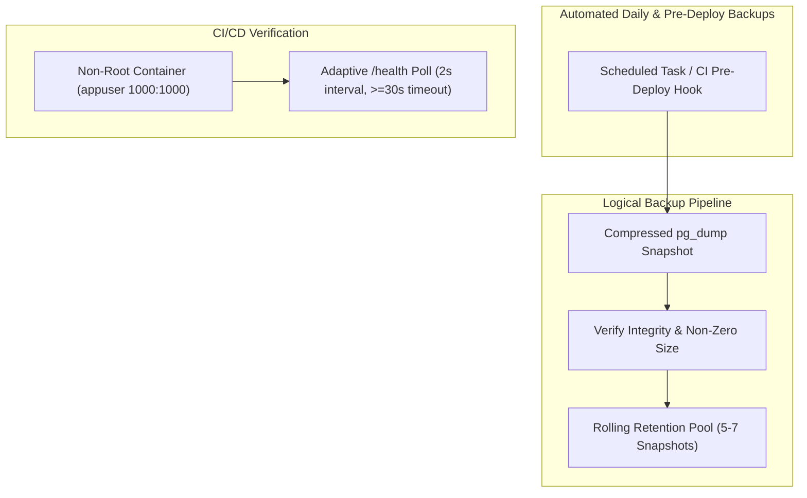

# Security, Governance & Reliability Architecture (Deus Battery ERP)

---

## 1. Threat Modeling (STRIDE Methodology)

High-capacity electro-chemical battery manufacturing and storage facilities present severe physical, financial, and operational safety risks. The system implements defense-in-depth mitigations structured according to the **STRIDE** model:

| Threat Category | Potential Attack Vector | Architectural Mitigation |
|---|---|---|
| **Spoofing** | Forged technician identity, credential sharing, or weak JWT secret in production | Adaptive password hashing, Single Active Session Guard, and Fail-Fast `JWT_SECRET_KEY` startup validation in `production`. |
| **Tampering** | Unauthorized mutation of battery readiness or cross-deducting personal cells | Server-side RBAC enforcement, enum validation, and `PERSONAL` ownership protection during BOM execution. |
| **Repudiation** | Operator denies issuing, modifying, or writing off battery inventory | Append-only (application-level) `AuditLog` capturing actor ID, timestamp, client IP, action tag, and JSON state deltas. |
| **Information Disclosure** | Static path-normalization bypass (`/static//uploads/receipts/...`) or QR enumeration | Physical isolation of receipts in `data/uploads/receipts` outside `/static`, `Cache-Control: private, no-store`, and 128-bit opaque QR tokens. |
| **Denial of Service** | Concurrent request flood or duplicate double-click submissions | Connection pooling, row-level lock timeouts, 100-item pagination, and client-side double-click guards. |
| **Elevation of Privilege** | Hardcoded admin IDs or `worker` invoking BOM/financial mutations | Empty-default env-only admin allowlists (`TELEGRAM_ADMIN_CHAT_IDS`) and FastAPI `require_role` dependency injection. |

---

## 2. Hardened Receipt Storage & Cryptographic Guards

### 2.1. Physical Isolation of Protected Receipts
In earlier architectures, storing receipts under a mounted static subtree risked path-normalization bypasses (e.g., `/static//uploads/receipts/{filename}`). **Deus Battery ERP** physically isolates all uploaded receipts into `data/uploads/receipts` outside the public `/static` mount:
- Unauthenticated path-traversal attempts return `HTTP 404 Not Found`.
- Direct route requests without a valid JWT return `HTTP 401 Unauthorized`.
- Authorized downloads return `HTTP 200 OK` with `Cache-Control: private, no-cache, no-store, must-revalidate`.

### 2.2. Fail-Fast Production Cryptographic Guard
On application startup (`app/config.py`), `_resolve_jwt_secret()` validates `JWT_SECRET_KEY` against known insecure placeholders. When `ENVIRONMENT=production`, starting with a default or weak key raises `RuntimeError` immediately, preventing insecure deployments.

### 2.3. Zero Hardcoded Administrative Identifiers
Administrative notification allowlists (`TELEGRAM_ADMIN_CHAT_IDS`) default to empty strings and are loaded exclusively from server environment configuration, rejecting unauthorized broadcast attempts by default.

---

## 3. Cryptographic QR Tokenization & Single Active Session Guard

Every physical asset receives a 128-bit cryptographically random token (`secrets.token_urlsafe(16)`), preventing sequential inventory enumeration.

---

## 4. Role-Based Access Control (RBAC) Matrix

| Operational Capability | `worker` | `leader` | `admin` |
|---|:---:|:---:|:---:|
| User Authentication & Single-Session Verification | Yes | Yes | Yes |
| Read Inventory Registry & Battery Telemetry | Yes | Yes | Yes |
| Resolve Item by QR Token | Yes | Yes | Yes |
| Check-out / Check-in Asset Assignment | Yes | Yes | Yes |
| Create & Transition Production Orders | Yes | Yes | Yes |
| Submit & Close Maintenance / Balancing Tickets | Yes | Yes | Yes |
| Query Embedded AI Assistant (Encrypted Chat History) | Yes | Yes | Yes |
| Govern Order Pricing, Services, Costs & Margins | No | Yes | Yes |
| Verify Order Payment Status & Download Receipts | No | Yes | Yes |
| Inspect Financial Valuation & Performer Payouts | No | Yes | Yes |
| Execute BOM Battery Pack Assembly (up to 5,000 units) | No | Yes | Yes |
| Create / Modify Inventory SKUs, Templates & Categories | No | Yes | Yes |
| Asset Scrapping & Inbound Procurement | No | Yes | Yes |
| Export Registry & Structured Reports | No | Yes | Yes |
| Inspect Append-Only Audit Trail Logs | No | Yes | Yes |
| User Account Administration & Session Revocation | No | No | Yes |
| Trigger Database Backups & Client Downloads | No | No | Yes |

---

## 5. Append-Only Audit Trail & AI Chat Security

- **Append-Only Audit Logging:** Every state mutation inserts an immutable record into `audit_logs` (`user_id`, `username`, `client_ip`, `action`, `entity_code` capped at 64 chars, `details` JSON delta).
- **Encrypted AI Conversations:** AI assistant dialogs (`ai_chat_sessions`, `ai_chat_messages`) are encrypted at rest via Fernet symmetric encryption.

---

## 6. Resilience, CI/CD & Automated Verification

- **Recovery Metrics:** RPO $< 24$ hours; RTO $< 15$ minutes via automated restore pipelines and client-authorized backup downloads.
- **Automated Verification (`204+` `pytest` tests):** Continuous regression suite validating security hardening (`test_security_and_optimization_patch.py`), auth/session guards, concurrency locks, BOM atomicity, and UI/system invariants.

---

## 7. Related Technical Specifications

- [System Landing & Project Overview](README.md)
- [System Architecture Specification](ARCHITECTURE.md)
- [Traceability & Battery Lifecycle](TRACEABILITY_AND_LIFECYCLE.md)
