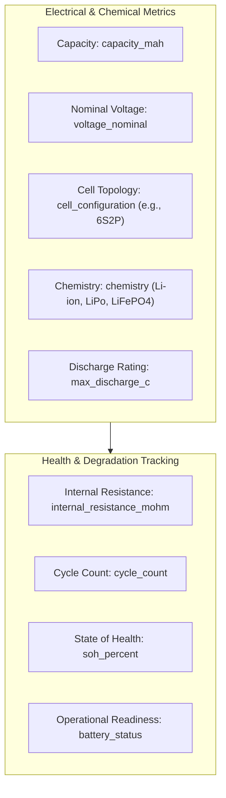
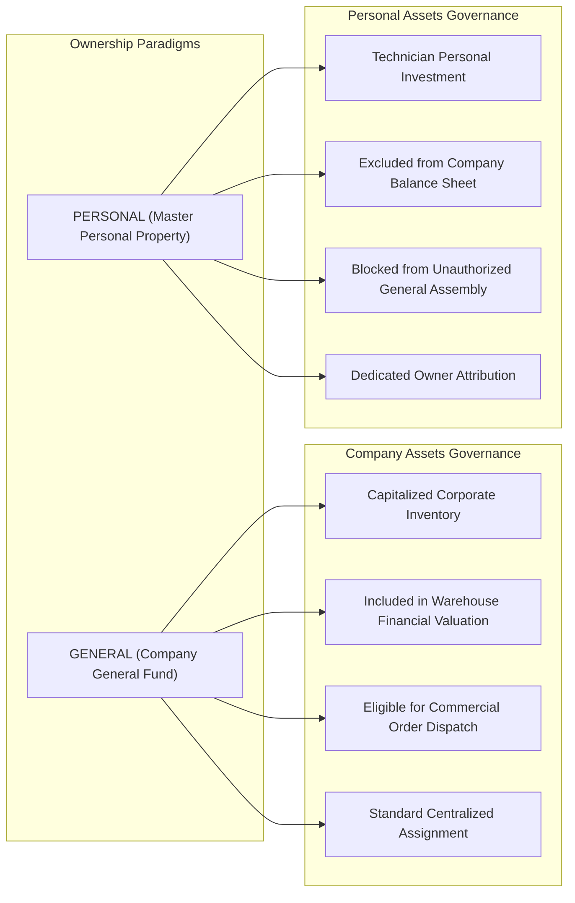
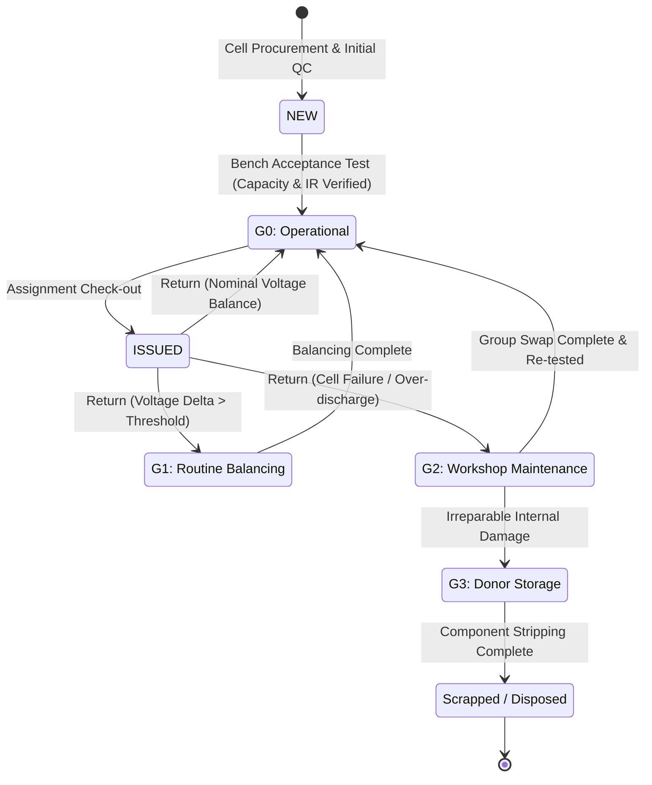
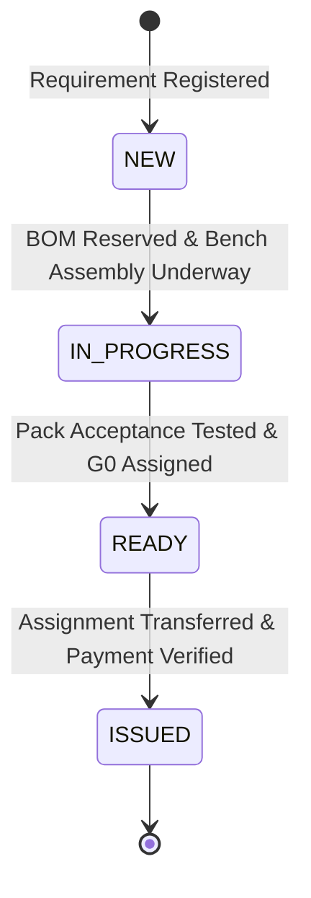

# Battery Traceability, Electro-Chemical Telemetry & Lifecycle Specification (Deus Battery ERP)

---

## 1. Domain Scope & Inventory Classification

Manufacturing high-reliability battery packs for industrial robotics and autonomous systems requires strict differentiation between raw electro-chemical cells, electronic BMS regulators, structural consumables, and assembled battery packs. **Deus Battery ERP (ERP 1.1)** organizes inventory across **customizable hardware domains** (`app/routers/customization.py`), mapping each to a deterministic prefix and an accounting paradigm:

| Category Name | SKU Prefix | Accounting Type | Primary Inventory Classification |
|---|:---:|:---:|---|
| **Raw Battery Cells** | `CEL` | `BULK` | 21700 / 18650 Li-ion cells |
| **Battery Management Systems** | `BMS` | `BULK` | Smart balance boards, PCM protection circuits |
| **Finished Battery Packs** | `BAT` | `BULK` / `PIECE` | Assembled multi-cell power units (e.g., 6S2P, 4S1P, 12S2P) |
| **Silicon Wiring & Leads** | `WIR` | `BULK` | High-temperature AWG silicone power wiring |
| **Connectors & Hardware** | `CON` | `BULK` | High-current anti-spark connectors, balance leads |
| **Nickel Strip & Interconnects** | `NIC` | `BULK` | Pure nickel welding strips, copper-nickel busbars |
| **Insulation & Heat Shrink** | `INS` | `BULK` | PVC/PET heat shrink wrap, Kapton polyimide tape |
| **Laboratory Tooling** | `TLS` | `BULK` | Precision spot welders, balance chargers, IR meters |
| **Testing Analyzers** | `EQP` | `BULK` / `PIECE` | Multi-channel programmable DC loads, thermal cameras |
| **General Workshop Ancillary** | `OTH` | `BULK` | Structural 3D printed end-caps, mounting brackets |

---

## 2. Electro-Chemical Telemetry & Battery Health Models

Every serialized battery pack and test batch records physical, electrical, and degradation metrics:

### Parameter Formulations:
- **State of Health ($\text{SOH}\%$):**
  $$\text{SOH} = \left(\frac{C_{\text{measured}}}{C_{\text{nominal}}}\right) \times 100\%$$
- **Internal Resistance ($R_{\text{int}}$ in $m\Omega$):** Primary indicator of cell aging and thermal risk; excessive drift triggers automatic degradation from `G0` to `G1` (Balancing) or `G2` (Cell Group Swap).

---

## 3. Dual-Ownership Accounting Paradigm & Cross-Entity Protection

### Invariant Protection (ERP 1.1):
- **Financial Balance Protection:** Automated financial analytics calculate warehouse valuation strictly over `ownership_type == 'GENERAL'`.
- **Cross-Entity Personal Stock Guard:** General production assemblies are blocked from consuming another technician's `PERSONAL` cells, returning a structured error identifying the owner and asset code.

---

## 4. ERP 1.1 BOM Scaling, Group-Batch & Template Replenishment

1. **Scaled Batch Output:** Single assembly transactions support up to `5,000` units with unlimited BOM component rows (`specific_inventory_number` up to `64` chars) and global cross-category component search.
2. **Template-Bound Replenishment (`assembly_template_id`):** Finished packs/assemblies can replenish existing group-batch (`BULK`) inventory lines created by the matching BOM template.
3. **Selectable Costing Strategy:** Upon replenishment, technicians choose between weighted-average unit cost recalculation or preserving the existing accounting cost basis.
4. **Compact Assembly Audit:** `GET /api/v1/assembly/history/{log_id}` exposes complete consumed component genealogy, batch prices, and master notes (`Item.note`).

---

## 5. Readiness Classification Finite State Machine (FSM)

---

## 6. Production Request, Order Services & Receipt Lifecycle

- **Order Services Journal (`order_services`):** Tracks auxiliary workshop services per order with independent performer settlement (`is_paid`) decoupled from client order payment status.
- **Protected Receipt Archival:** Supports `.jpg`, `.jpeg`, `.png`, `.pdf`, `.webp`, `.heic`, and `.heif` receipts stored in `data/uploads/receipts` and served exclusively behind JWT verification (`Authorization: Bearer` or scoped `?token=` with `Content-Disposition: attachment` support).

---

## 7. Specifications Reference

- **[System Landing & Project Overview](README.md)**
- **[System Architecture Specification](ARCHITECTURE.md)**
- **[Security, Governance & Resilience](SECURITY_AND_RELIABILITY.md)**
