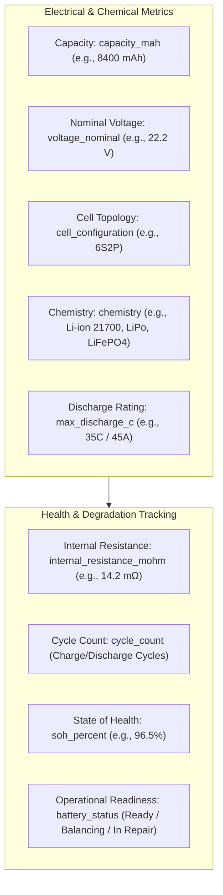
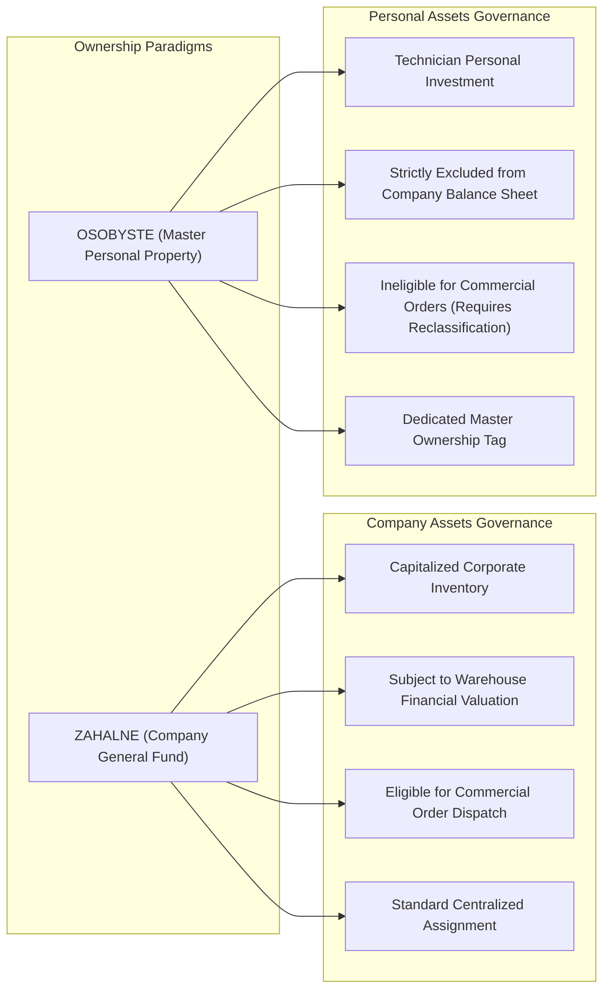
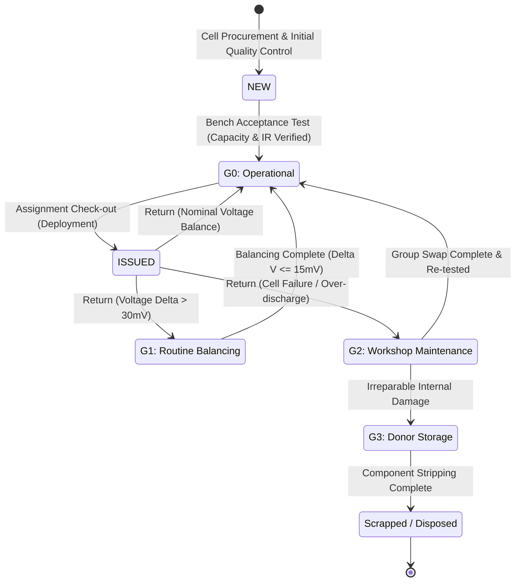
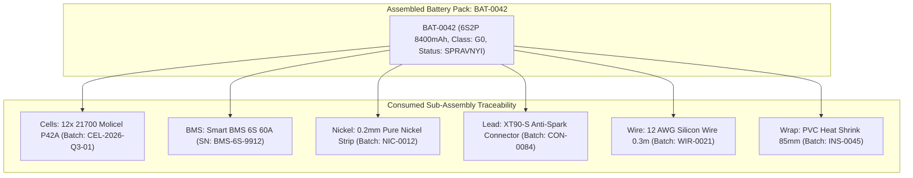
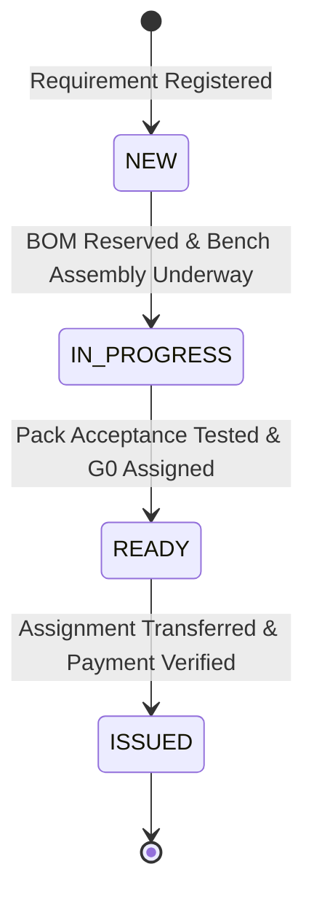

# Battery Traceability, Electro-Chemical Telemetry & Lifecycle Specification (Deus Battery ERP)

---

## 1. Domain Scope & Inventory Classification

Manufacturing high-reliability battery packs for industrial robotics and battery platforms requires strict differentiation between raw electro-chemical cells, electronic BMS regulators, structural consumables, and fully serialized battery packs. **Deus Battery ERP** organizes inventory across standardized hardware domains, mapping each to a deterministic prefix and an accounting paradigm:

| Category Name | SKU Prefix | Accounting Type | Primary Inventory Classification |
|---|:---:|:---:|---|
| **Raw Battery Cells** | `CEL` | `BULK` | 21700 / 18650 Li-ion cells (Molicel, Samsung, LG, Panasonic) |
| **Battery Management Systems** | `BMS` | `BULK` | Smart balance boards, PCM protection circuits, CAN/SMBus telemetry |
| **Finished Battery Packs** | `BAT` | `PIECE` | Assembled multi-cell power units (e.g. 6S2P, 4S1P, 12S2P) |
| **Silicon Wiring & Leads** | `WIR` | `BULK` | High-temperature AWG silicone power wiring (10–18 AWG) |
| **Connectors & Hardware** | `CON` | `BULK` | Amass XT30, XT60, XT90, AS150 anti-spark, JST-XH balance leads |
| **Nickel Strip & Interconnects** | `NIC` | `BULK` | Pure nickel welding strips, copper-nickel sandwich busbars |
| **Insulation & Heat Shrink** | `INS` | `BULK` | PVC/PET heat shrink wrap, barley paper, Kapton polyimide tape |
| **Laboratory Tooling** | `TLS` | `BULK` | Precision spot welders, electronic balance chargers, internal resistance meters |
| **Testing Analyzers** | `EQP` | `PIECE` | Multi-channel programmable electronic DC loads, thermal imaging cameras |
| **General Workshop Ancillary** | `OTH` | `BULK` | Structural 3D printed end-caps, mounting brackets, silicone sealant |

---

## 2. Electro-Chemical Telemetry & Battery Health Models

Every serialized battery pack (`PIECE`) and discrete test batch records comprehensive physical, electrical, and degradation metrics:

### 2.1. Parameter Definitions & Degradation Mechanics
- **Internal Resistance ($R_{\text{int}}$ in $m\Omega$):** Primary indicator of cell aging and thermal risk. Measured via 1kHz AC milliohm meter or DC delta-voltage method during acceptance testing. Values exceeding $150\%$ of baseline trigger automatic degradation to `G1` (Balancing/Maintenance) or `G2` (Cell Swap).
- **State of Health ($\text{SOH}\%$):** Calculated relative to factory rated capacity:
  $$\text{SOH} = \left(\frac{C_{\text{measured}}}{C_{\text{nominal}}}\right) \times 100\%$$
- **Cell Topology Notation:** Standardized series-parallel strings (`XS YP`):
  - *Example 6S2P:* 6 cells in series (nominal $6 \times 3.6\text{V} = 21.6\text{V}$, maximum $25.2\text{V}$), 2 strings in parallel doubling overall discharge capacity.

---

## 3. Dual-Ownership Accounting Paradigm

To accommodate master technicians fabricating personal equipment alongside commercial workshop throughput, the platform enforces architectural separation of ownership:

### Invariant Protection:
- **Financial Balance Protection:** Automated financial analytics services calculate warehouse balance strictly over items where `ownership_type == 'ZAHALNE'`. Personal units cannot artificially inflate corporate working capital.
- **Assembly Distinction:** In the BOM assembly engine, masters can explicitly designate an assembly run as personal via `is_personal = true`, creating the output asset with `ownership_type = 'OSOBYSTE'`.

---

## 4. Readiness Classification Finite State Machine (FSM)

Physical battery packs and sub-assemblies are governed by a multi-state finite state machine evaluating operational and safety readiness (`G0`–`G3`):

### 4.1. Readiness Classes (`readiness_class`)
- **`G0` (Operational):** Battery pack passes full acceptance testing: cell voltage delta $\Delta V \le 15\text{mV}$, internal resistance within factory nominal bounds, and physical insulation intact.
- **`G1` (Routine Servicing / Cell Balancing):** Pack functional but exhibits voltage drift ($\Delta V > 30\text{mV}$ between parallel groups), balance lead wire wear, or minor outer heat-shrink abrasions. Requires balancing charger service.
- **`G2` (Workshop Repair / Cell Group Replacement):** Pack unserviceable due to an underperforming parallel cell group, damaged BMS, or high internal resistance. Requires disassembly and rebuild.
- **`G3` (Retired / Donor Cells):** Pack degraded below $70\%\text{ SOH}$ or suffering physical impact damage. Disassembled strictly to salvage viable connectors, balance leads, or individual functional cells.

### 4.2. FSM State Transition Workflow

---

## 5. End-to-End Battery Pack Passport & Genealogy

Every assembled battery pack receives an append-only digital passport linking the finished product to its exact sub-components:

### Traceability Applications:
- **Forward Impact Analysis (Cell Batch Recall):** If laboratory testing flags an entire inbound cell batch (`CEL-2026-Q3-01`) as susceptible to thermal degradation, an automated query identifies all assembled packs containing cells from that batch:
  $$\text{AffectedPacks} = \Pi_{\text{assembled\_item\_id}}(\sigma_{\text{consumed\_inventory\_number} = \text{'CEL-2026-Q3-01'}}(\text{AssemblyConsumedItem}))$$
- **Backward Forensic Analysis:** Following an operational power failure, technicians inspect the digital passport to extract the precise spot-welding technician, assembly date, initial internal resistance telemetry, and component supply invoices.

---

## 6. Production Request & Order Lifecycle (CRM FSM)

Inbound battery manufacturing and issue requests follow a deterministic Finite State Machine:

### Operational Stages:
1. **`NEW`**: Registered requirement specifying target pack configuration, voltage, capacity, customer entity, target completion date, and priority tag (`LOW`, `NORMAL`, `URGENT`, `CRITICAL`).
2. **`IN_PROGRESS`**: Assigned to lead assembly technician. Sub-component BOM cell reservation is verified in inventory.
3. **`READY`**: Battery pack assembly complete, balancing test verified, prime cost (`cost_price`) calculated, and customer price confirmed.
4. **`ISSUED`**: Physical handover executed. Linked to payment verification (`is_paid = true`) and settlement confirmation.

---

## 7. Specifications Reference

- **[System Landing & Project Overview](README.md)**
- **[System Architecture Specification](ARCHITECTURE.md)**
- **[Security, Governance & Resilience Specification](SECURITY_AND_RELIABILITY.md)**
